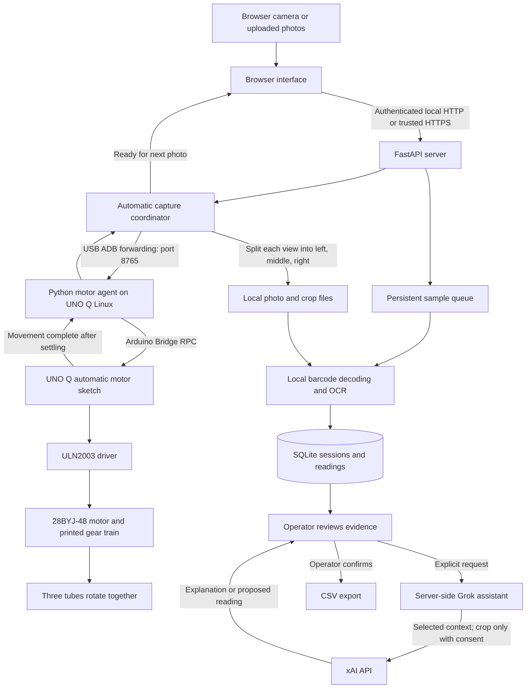

# Three-Tube Sample Scanner

A motorized sample-label scanner built for the MRG Laboratories challenge: photograph three tubes, save each tube as an independent sample, read its label, review uncertain fields, and export a CSV.

We built the system by combining a 3D-printed geared holder, an Arduino UNO Q motor controller, a browser camera interface, local OCR, and an optional **xAI Grok review assistant**. Grok helps the operator resolve difficult label readings; local OCR handles the normal processing path. The integration in this repository is xAI Grok, not a separate SpaceX service.

[Windows setup](#set-up-on-a-new-windows-laptop) · [Phone setup](#connect-an-iphone-over-local-https) · [Architecture](#architecture) · [Grok assistant](#how-the-xai-grok-assistant-helps) · [Hardware files](hardware/final%20files/) · [Detailed assistant configuration](ASSISTANT.md)

## What the prototype does

- Accepts browser camera captures, 1–8 uploaded photos of one tube, or a ZIP with one folder per tube.
- In automatic mode, captures eight stopped views of three tubes and saves **three samples with eight images each**.
- Decodes barcodes and reads Small/Large label fields with local OCR, preserving evidence for review.
- Lets an operator correct readings, request optional Grok assistance, confirm samples, and export CSV records.
- Runs the server on a laptop or a prepared Raspberry Pi. The current USB motor setup was exercised with a Windows laptop and UNO Q.

**Current validation:** the merged version passed 71 Python tests and the JavaScript capture checks. Motor movement and settling were tested, and smooth physical movement was confirmed. A complete iPhone automatic scan still needs a real end-to-end check. Tests do not establish OCR accuracy or guarantee that gears never slip.

## Architecture



The laptop hosts the website, coordinates capture, and runs OCR. The UNO Q handles motor commands through its Linux-side agent and microcontroller sketch. The phone supplies camera images; it does not connect directly to the motor driver. SQLite stores sessions, queue state, readings, and review records; image files stay in the local `uploads/` directory.

### Automatic capture sequence

1. The operator fixes the camera in landscape with one complete tube in each third of the image and chooses **Three tubes on the rotating base**.
2. The browser starts a scan and captures the first view while the tubes are stationary.
3. For each of seven further views, the server requests a bounded motor movement, waits for completion and the 0.5-second settling pause, then lets the browser capture a fresh frame.
4. Each full frame is divided into three fixed image regions. After all eight views arrive, the server queues three separate samples for OCR.
5. The operator reviews barcode identity and label readings, then exports the confirmed records.

The nominal views are 0°, 45°, …, 315°. These are step-count estimates, not measured positions. The gears rotate all three tubes together; separate image groups do not mean independent motor control. Capture uses fixed intervals, not label detection to decide when to stop. The controller watchdog stops movement if status heartbeats disappear. A failed scan is not queued as a completed three-sample batch.

### How we built it

| Layer | Implementation and purpose |
|---|---|
| Mechanical fixture | OpenSCAD models, separate printed gears/washers, cap holders for approximately 17 mm caps, and boltless parts. Print packages target the Bambu P1P with a 0.4 mm nozzle and PLA. |
| Motion | A 28BYJ-48 motor through a ULN2003 driver; UNO Q firmware provides bounded movement, settling, stop, and heartbeat protection. |
| Capture | Browser camera preview, three-region framing, manual capture, and an automatic eight-view sequence. |
| Processing | Python/FastAPI, a persistent queue, OpenCV image processing, ZXing barcode decoding, RapidOCR and local recognizers. |
| Review | Field crops beside editable values, warnings, optional Grok explanations/readings, human confirmation, and CSV export. |
| Deployment | A local Python environment, predownloaded models, USB forwarding to UNO Q, and optional trusted local HTTPS for a phone. |

## How the xAI Grok assistant helps

The assistant is an optional second opinion during review. It is off by default and runs outside the OCR worker, so local scanning can continue when cloud assistance is unavailable.

| Operator problem | Implemented assistant action | Operator's next step |
|---|---|---|
| A field has a warning | Explain the recorded warning and what to inspect | Compare the explanation with the crop and original views |
| Glare, blur, or curved labels make reading difficult | Give photo advice | Adjust lighting, focus, or angle and capture better evidence |
| Handwriting is hard to read | With explicit consent, send the selected field crop and request a proposed reading or an unreadable response | Inspect the proposal; use it only if supported by the image |
| A suggestion needs clarification | Ask a short follow-up question | Resolve uncertainty before confirmation |

For example, when a date is flagged, Grok can explain the warning. If the digits remain unclear, the operator can explicitly ask it to read that field. **Use suggestion** fills the normal unconfirmed review field; it does not mark the sample correct. Barcode decoding remains authoritative for Sample ID, and assistant Sample ID proposals cannot be applied through the suggestion action.

Grok does not drive the motor, automatically fix hardware, diagnose sample condition, infer machine health, or approve laboratory results. Its role is to help an operator resolve label-reading problems. Faster or more accurate review is an evaluation goal, not a measured result claimed here.

To enable it, set these variables in the same PowerShell session used to launch the server:

```powershell
$env:ASSISTANT_ENABLED = "true"
$env:XAI_API_KEY = "YOUR_PRIVATE_XAI_API_KEY"
# Optional: enable the explicit, consent-based field-image action.
$env:ASSISTANT_IMAGE_ENABLED = "true"
```

Keep the key private. Text assistance sends selected field context to xAI; the image action additionally sends the selected crop after confirmation. The server supplies no browsing or code-execution tools to the assistant. Model configuration, request limits, retention, authentication, and evaluation instructions are in [ASSISTANT.md](ASSISTANT.md). A live provider call requires internet and an appropriately configured xAI account; automated tests use mocks.

## Set up on a new Windows laptop

Use the current `main` branch. Install Git, a compatible 64-bit Python, and Arduino App Lab/UNO Q tools if using motor control. Do not copy another computer's virtual environment. The existing motor firmware remains on the same UNO Q when changing laptops.

In PowerShell:

```powershell
git clone --branch main https://github.com/ahellmann201/YCP_Hacks_Fa_26.git
cd YCP_Hacks_Fa_26
py -3 -m venv .venv-ocr
.\.venv-ocr\Scripts\python.exe -m pip install --upgrade pip
.\.venv-ocr\Scripts\python.exe -m pip install -r requirements.txt -r requirements-heic.txt cryptography
.\.venv-ocr\Scripts\python.exe tools\prepare_models.py
.\.venv-ocr\Scripts\python.exe tools\prepare_models.py --check
```

Installation and initial model preparation need internet. Continue when the offline check reports that the app OCR models loaded successfully. `cryptography` is required by the local HTTPS setup script; HEIC support is optional for JPEG-only uploads.

Start the server:

```powershell
.\.venv-ocr\Scripts\python.exe scripts\start_automatic_scanner.py
```

Leave the terminal open. On a fresh checkout without HTTPS configuration, open **http://127.0.0.1:8000** on this laptop. The launcher generates a private login file. Display it locally in a second project terminal:

```powershell
Get-Content .env.automatic-scanner
```

Use its username/password to sign in. Choose or create a session, upload one tube's photos, and check the OCR results before adding motor or phone setup. GitHub does not contain previous sample photos, session databases, passwords, or private certificates.

### Connect the existing UNO Q

Keep the tested motor/driver wiring and power arrangement. Connect the board over USB and confirm App Lab detects it, then run:

```powershell
powershell -ExecutionPolicy Bypass -File hardware\connect_motor_usb.ps1
```

Expected: **UNO Q connected**, followed by a motor state. Repeat after reconnecting USB. The script expects Arduino's ADB executable at `%LOCALAPPDATA%\Arduino15\packages\arduino\tools\adb\32.0.0\adb.exe`; a different installed tool version requires adjusting that path.

This command only establishes USB forwarding and checks status. It does not install the board-side agent or firmware. For the existing configured board, retain its `uno_q_scan_agent.py` service and `motor_scan/motor_scan.ino` sketch. If the agent is stopped, restore it before retrying. A fresh UNO Q requires separate agent and firmware provisioning; this repository does not yet provide a one-command provisioning script. Uploading `motor_test.ino` replaces automatic control with manual testing.

See [automatic scan notes](hardware/final%20files/AUTOMATIC_SCAN_START_HERE.txt) and [motor source](hardware/final%20files/motor_scan/motor_scan.ino). Ignore old machine-specific IP addresses in historical notes; use the new laptop's address.

## Connect an iPhone over local HTTPS

First verify the laptop-only page. Connect the laptop and phone through the same reachable network; an iPhone hotspot can avoid campus Wi-Fi client isolation. Run `ipconfig` and use the active Wi-Fi adapter's IPv4 address, not an address copied from another computer.

Stop the scanner with Ctrl+C. Replace `YOUR_LAPTOP_IP` with the actual address:

```powershell
.\.venv-ocr\Scripts\python.exe scripts\setup_local_https.py YOUR_LAPTOP_IP
New-Item -ItemType Directory -Force tmp\automatic-scanner
```

Open PowerShell **as Administrator**, change to this project folder, and allow the local ports:

```powershell
powershell -ExecutionPolicy Bypass -File scripts\allow_local_scanner.ps1
```

In two normal project terminals, leave these running:

```powershell
# Terminal 1: public certificate installation page
.\.venv-ocr\Scripts\python.exe scripts\serve_iphone_certificate.py
```

```powershell
# Terminal 2: authenticated HTTPS scanner
.\.venv-ocr\Scripts\python.exe scripts\start_automatic_scanner.py
```

1. Open `http://YOUR_LAPTOP_IP:8081` in Safari and download the profile.
2. Open **Settings → General → VPN & Device Management**, select the downloaded profile, and install it.
3. Enable the scanner certificate under **General → About → Certificate Trust Settings**.
4. Open `https://YOUR_LAPTOP_IP:8443` and sign in using the new laptop's login.
5. Choose a session, select three-tube mode, allow camera access, and check the live preview before scanning.
6. Start with **Original** motor speed. Keep Safari visible and the phone unlocked; verify that three samples with eight views each arrive for review.

A new laptop generates a new certificate authority, so trusting the old laptop's certificate is insufficient. If the laptop IP changes, stop the servers, regenerate its server certificate with the same setup command, rerun the firewall script, and restart both servers. The existing CA is reused when its private configuration remains in place. Do not publish `.env.*` files or private keys.

## Run the local OCR server on a Raspberry Pi

Use a 64-bit Pi OS with compatible inference wheels. The development Pi was a Pi 3 Model B with 64-bit Debian; a new OS/Python combination still needs validation. This sets up OCR/review, not the Windows-specific USB motor connection.

```bash
sudo apt update
sudo apt install -y git python3-venv python3-pip libgomp1
git clone --branch main https://github.com/ahellmann201/YCP_Hacks_Fa_26.git ~/sample-scanner
cd ~/sample-scanner
python3 -m venv .venv-ocr
.venv-ocr/bin/python -m pip install --upgrade pip
.venv-ocr/bin/python -m pip install -r requirements.txt
.venv-ocr/bin/python tools/prepare_models.py
.venv-ocr/bin/python tools/prepare_models.py --check
export SCANNER_ACCESS_PASSWORD='REPLACE_WITH_A_LONG_RANDOM_PASSWORD'
bash start-scanner.sh
```

The server binds to loopback by default. Use it locally at `http://127.0.0.1:8000`, or configure trusted HTTPS for remote devices as described in [ASSISTANT.md](ASSISTANT.md). Keep one server worker. GPU training is a separate environment documented in [tube-training/README.md](tube-training/README.md).

## Review, export, and update

Review crops and originals, correct fields, and select **All good — include in CSV**. **Download current CSV** leaves the session available. **Download CSV & finish session** downloads the CSV and clears that session's photos/crops. Closing the browser does not finish a session.

**Starting the server empties its local `uploads/` directory.** Saved field records remain in SQLite, but export required work and back up matching database/photos before restarting or updating. A Git push is not a sample-data backup.

For a clean checkout already on `main`, stop the server and run `git pull --ff-only`, then restart. If local changes exist, preserve them before updating; do not hard-reset to resolve them.

| Problem | First check |
|---|---|
| Phone page times out | Same reachable network, correct current IP, running servers, firewall ports 8081/8443 |
| Certificate missing from trust settings | Install the downloaded profile first; downloading alone does not install it |
| No live camera picture | Trusted HTTPS, browser permission, visible camera controls, and selected camera; test laptop capture separately |
| UNO Q offline | USB data cable, App Lab connection, installed ADB tools, then rerun the USB connection script |
| Motor status fails despite USB connection | Automatic firmware and the board-side agent must both be running |
| Missing OCR models | Prepare online, then rerun `tools/prepare_models.py --check` |
| Grok unavailable | Server environment/key, enabled flags, internet, account limits; local OCR remains usable |
| Wrong reading or crop | Inspect originals, capture a better view, and correct the field; AI agreement is not proof |

More detail: [batch ZIP intake](docs/BATCH_IMPORT.md), [review and cleanup](docs/REVIEW_AND_CLEANUP.md), [session metrics](docs/SESSION_METRICS.md).

## Performance and limits

The user-run three-thread Pi benchmark tested **10 tubes twice each**: **20.8s average/tube**, **27.4s slowest tube mean**, **10/10 below 30s mean**, and **329.5 MiB peak OCR worker memory**. Repeated readings matched. It measured saved-photo OCR and preview generation, excluding upload, ZIP preparation, queue wait, manual review and whole-app memory. Later crop/quality updates have not been rebenchmarked over that set.

Three threads help **one worker**; tubes are still processed sequentially and models reload per tube. Matching repeated outputs do not prove accuracy. Cursive, smears, glare, clipping and curvature still need review. The smudge-augmented English model handles Small-label machine/serial crops; other paths retain RapidOCR. Small development comparisons improved from 5/9 to 6/9 clean fields and from 13/27 to 18/27 synthetic-smudge fields; these are not general accuracy estimates. [Smudge experiment and limits](tube-training/SMUDGE_TRAINING.md). [Thread guide](docs/OCR_THREADS.md) · [Model comparison](tube-training/MODEL_COMPARISON.md).

Valid full dates accept `.`, `-` or `/` and display/export as **MM/DD/YYYY**. Two-digit full-date years use 20xx. Partial dates keep their components with `/` separators; no missing day/year is invented. Raw OCR remains saved. Formatting does not repair wrong digits. Machine and serial punctuation are untouched. Date accuracy treats equivalent separators/formatting as equal.

## CSV mapping

| Column | Large label | Small label |
|---|---|---|
| Sample ID | Decoded barcode | Decoded barcode |
| Date Sampled | Written Date | Written Date |
| Date Received | Upload date; editable | Upload date; editable |
| Machine | Equip ID | RN |
| Component | Sample Point | Circled number + GS/NGS |
| Serial Number | Blank | SN, uppercase |
| Reference Lube | Ref Lube | Blank |

## File layout and developer checks

For optional Grok review help, authentication, privacy, and Pi deployment, see [Grok assistant setup](ASSISTANT.md).

| Location | Purpose |
|---|---|
| `README.md`, `start-scanner.sh`, `Start Scanner.bat` | This guide and the two launchers. They stay in the project root. |
| `main.py`, `static/` | FastAPI entry point, MRG logo, and phone/browser interface |
| `automatic_capture.py` | Motor-coordinated capture and separate sample assembly |
| `hardware/final files/` | Print packages, motor firmware, board-side agent and assembly notes |
| `scripts/` | Startup, local HTTPS and network setup helpers |
| `grok_assistant.py`, `ASSISTANT.md` | Optional xAI review integration and configuration |
| `scanner/queue/` | Background scan queue |
| `scanner/io/` | Sessions, upload cleanup, and ZIP intake |
| `scanner/vision/` | Label alignment, crops, and circled component marks |
| `scanner/reading/` | OCR settings, field text, and the photo-reading pipeline |
| `scripts/start_demo.sh` | Pi startup details used by `start-scanner.sh`; defaults to three OCR threads |
| `tools/` | Model preparation, barcode/handwriting diagnostics, throughput benchmark |
| `tests/` | App regression tests with disposable data |
| `docs/` | ZIP, metrics, review/cleanup and thread guides |
| `tube-training/` | Separate labeling, Windows training/conversion tools and their tests |
| `trained-model/` | Offline models, dictionaries and provenance |
| `legacy/` | Earlier unused OCR worker |
| `uploads/`, `scanner.sqlite3` | Local photo/crop files and session/field records; ignored by Git. `uploads/` is emptied when the server starts. |

Run from the repository root with the inference dependencies installed. The following uses Linux virtual-environment paths; on Windows use `.\.venv-ocr\Scripts\python.exe`. The capture check requires Node.js.

```bash
.venv-ocr/bin/python -m pip install pytest
.venv-ocr/bin/python -m pytest tests -q
node tests/check_three_tube_capture.cjs
.venv-ocr/bin/python tools/benchmark_threads.py --samples 10 --thread-counts 3 --repeats 2
.venv-ocr/bin/python tools/test_barcode.py "PATH/TO/PHOTO.jpg"
.venv-ocr/bin/python tools/test_handwriting.py "PATH/TO/PHOTO.jpg"
```

Stop the app for comparable benchmark measurements. The full-tube benchmark and old handwriting timing tool use Linux resource measurements. Core logic has local Windows tests, but the complete Windows camera/demo workflow has not been validated. See [training setup](tube-training/README.md) for the separate GPU environment; do not install training dependencies on the Pi for inference.
